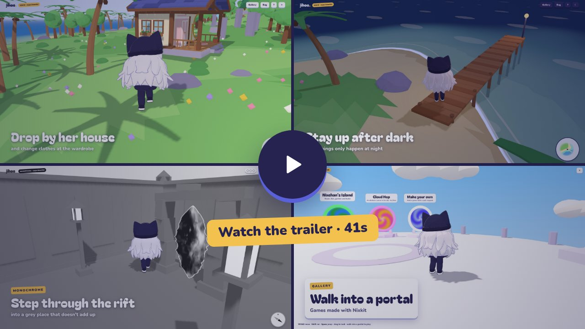

# Nixchan

Nixchan, a child of snow (*nix* is Latin for snow), and her world: an island to roam, a grey place
through a rift, a 3D path to walk, a gallery of portals to games, and her snow magic. TypeScript and
three.js, built with Astro and published on GitHub Pages at
[jihoo12.github.io/nixchan](https://jihoo12.github.io/nixchan/).

[](https://jihoo12.github.io/nixchan/trailer.mp4)

A 41-second trailer, recorded from the site itself ([`public/trailer.mp4`](public/trailer.mp4)).

She started out as a little NixOS personification on [jihoo's site](https://jihoo12.github.io/)
([jihoo12/jihoo12.github.io](https://github.com/jihoo12/jihoo12.github.io)), and grew into a
character of her own; this repository was split out of that one, history and all.

## Pages

All under `/nixchan/`:

- **Nixchan** (`/nixchan/`, `/nixchan/ko/`) — who she is.
- **Island** (`/island/`) — Nixchan's island, a small three.js game (see below).
- **Her house** (`/home/`) — through the front door on the island.
- **Monochrome** (`/monochrome/`) — the grey place through the rift at the island's standing stones (see below).
- **3D path** (`/experimental/`) — a walk past jihoo's projects, notes and comics, to the sky gate and the island. The projects, notes and comics come from jihoo's site as the page opens (`/home-scene.json`, the same origin).
- **Gallery** (`/gallery/`) — a plaza where Nixchan walks into portals to her games.
- **Games** (`/play/<id>/`) — games made with Nixkit (`src/lib/nixkit/`), one folder each in `src/games/`. Anyone can add one: see [CONTRIBUTING.md](CONTRIBUTING.md).

Every 3D page is drawn with three's WebGPURenderer (WebGPU, or WebGL 2 without it; `?webgl` on the
URL forces that) in Nixkit's engine, so their shaders are TSL. Nixchan walks the island, her house
and the grey place as Nixkit's player, told how each place has her move (`moves`, and the world's
`collide` for its walls); the 3D path moves her itself, as it scrolls.

Links to pages of this site go through `src/lib/base.ts` (`to('/island/')` is `/nixchan/island/`).
Saves are in `localStorage`, which this site shares with jihoo's (the same origin).

## Development

Tools come from the Nix flake (`nix develop`), which provides Node.js:

```sh
nix develop
npm ci
astro dev --background   # then open http://localhost:4321/nixchan/ ; stop with `astro dev stop`
npm run check            # types (astro check)
npm run check:games
npm test                 # Nixkit's unit tests (tools/test-nixkit-*.mjs)
npm run build
```

To look at the 3D pages, use a real browser on a real GPU. Headless Chromium draws them with a
software renderer, which neither looks nor runs like the real thing.

## Nixchan's Island

A toon island for Nixchan to roam: places to find, a map that fills in as she explores, a glider, fishing, a garden, Pebble the otter at the market stand, the Old Forge (iron ore to mine, tools to make better, and machines that look after the garden), and Cloudrest, islands floating in the sky that the Windspout's wind carries her glider up to: a ring temple, a lake with fish of its own, a spire, and crystals that grow back after she gathers their sky shards. It is TypeScript and three.js, with no physics engine: the island is a heightfield, so all movement asks is how high the ground is (and, under the sky island, how high she is).

The page is `src/pages/island/index.astro` (HTML/CSS for the menus and prompts), and the game is in `src/lib/island/`:

| Module | What it does |
| --- | --- |
| `game.ts` | Puts the island together and runs the frame |
| `terrain.ts`, `features.ts` | Heightfield, pier, and what stands on the ground (`groundAt`) |
| `layout.ts`, `scatter.ts` | Where the places go; rocks, trees and flowers |
| `sky.ts`, `water.ts`, `theme.ts` | Light, sky, sea, and day/night (parts register with `theme.on`) |
| `landmarks.ts` | Lighthouse, campfire, standing stones, chest, buoy |
| `skyisle.ts` | Cloudrest, the islands in the sky, and the Windspouts that lift her up to them |
| `look.ts` | The little geometries trees and rocks are made of (the toon shading is Nixkit's) |
| `explore.ts`, `menu.ts` | Places found, the maps, the menu |
| `fishing.ts`, `farm.ts`, `npc.ts`, `inventory.ts` | Things to do, and her bag |
| `house.ts` | Her cottage: the porch, the wardrobe and mirror, and the front door into `/nixchan/home/` |
| `talk.ts` | The conversation box and speech bubble everyone she talks to shares |
| `owl.ts` | Somebody who lives somewhere hard to find (spoilers inside) |
| `tortoise.ts`, `fourthwall.ts` | Parmen on the Lonely Islet, and the island's only door out: through the screen to `/nixchan/experimental/` |
| `forge.ts` | The smithy: ore veins, smelting (iron, and ashen ore from the grey place), and the upgrades made at the anvil |
| `machines.ts` | Sprinklers and Sprocket the clockwork helper, looking after the garden |
| `rift.ts` | The grey rift at the standing stones, through to `/nixchan/monochrome/` |
| `lantern.ts` | The Grey Lantern at her shoulder, made at the forge |
| `blocks.ts` | Stone blocks, made at the forge, that she builds with on a one-metre grid |
| `power.ts` | Windmills, the drills they power on the ore veins, and belts that carry ore (and power) to the hopper by the forge: power is only ever on or off, what's on a belt is worked out from when it set off, and a belt with power carries her too |
| `lang.ts` | Which language the island speaks (the site's; `?lang=ko` to try one), and the names to keep the same in both |
| `save.ts` | Every localStorage key the island uses |

Nixchan herself, how she moves, the follow camera, the keys and touch controls, and what E does
(`interact.ts`: sources register offers) are Nixkit's (`src/lib/nixkit/`), shared with the games.
So are the workings of `talk.ts`, `inventory.ts`, `menu.ts`, `save.ts`, `theme.ts` and `lang.ts`:
the island's files say only what's the island's own (its save keys, its palettes, its kinds of
thing, where its page keeps the box and the bag). Keys go through Nixkit's key router in layers
(the fourth wall, then a conversation, the menu, a shop, the wardrobe), and the camera's framing
through its focus. It draws with three's WebGPURenderer, as the games do (WebGPU, or WebGL 2
without it; `?webgl` on the URL forces that), so its own shaders are TSL: the sky, the sea, Cloudrest's
waterfalls and wind, the rift (`monochrome/rift-nodes.ts`), the mirror (three's reflector node) and
the ink lines round Pebble, Hollis, Parmen, the fish and the garden. And its frame is Nixkit's
engine's: `game.ts` makes an engine, puts Nixchan in it with `createNixchan` on the island's terrain,
and adds each part of the island to it as a system, in the engine's order.

To add something she can do, register it with `interactions.add(() => ({ label, go }))`. To add a landmark, add a function to `landmarks.ts`.

The fish, garden, otter, sky ruin, forge and power models (and the grey place's walls and pieces, `tools/monochrome/`) are made in Blender by the scripts in `tools/` (`nix develop .#blender -c blender -b -P tools/<name>/build.py -- <out.glb>`).

## Monochrome

The grey place through the rift. The rift opens between the island's standing stones at night, once Nixchan has opened the chest at the top of Cloudrest. Through it, everything is grey but her, and the place doesn't fit together the way a map would: a hall that runs on for ever, a wood that goes round, three cells round an obelisk where there ought to be four, a house bigger inside than out, and a tower it takes two laps to get round. Three colour shards are hidden in it; each one brings a little colour back, and they colour the rift and the altar crystal on the island once they're home. She can leave snowflakes on the floor (Q) to know a place again. Dark rocks here and there grow ashen ore, which she chips off and carries home: at the island's forge it smelts into ashen ingots, for a Rift Compass (whose needle then knows the way back to the Threshold from anywhere), a Grey Lantern, and, once all three shards are found, the Prism Glider.

There's no map underneath it. The world is a graph of square cells, each side either walled or joined to a side of some other cell, turned any way. Each frame asks "which cell is she in, and where in it?": the cells round hers are laid out flat round her as far as the fog (where two ways round reach the same spot, the shorter wins), and when she steps over a side, the cell she steps into becomes the middle and everything shifts back by a cell.

The page is `src/pages/monochrome/index.astro`, and the code is in `src/lib/monochrome/`:

| Module | What it does |
| --- | --- |
| `world.ts` | The cells and how they're joined, and `place`, which lays them out round her |
| `blocks.ts` | What each cell looks like (merged from the Blender pieces) and what in it is solid |
| `game.ts` | Stepping her from cell to cell, the camera, the shards, ashen ore, snowflakes and the compass |
| `moves.ts` | How she moves here, as Nixkit's player is told it: the walls, boxes and columns round her push her out as they always have (`tools/test-nixkit-grey-feel.mjs` keeps it feeling the same) |
| `rift.ts` | The rift, shared with the island: its shader (TSL) and its uniforms |

## Deployment

GitHub Actions builds and publishes the site at [jihoo12.github.io/nixchan](https://jihoo12.github.io/nixchan/). The base path is set in `astro.config.mjs`.

## Artwork

All the artwork is Nixchan and her world, drawn and modelled by jihoo:

- **Illustrations** — `src/assets/nixchan/*.png`, optimized at build time by `astro:assets`. (The rest of her illustrations are on jihoo's site.)
- **Live Nixchan** — `src/assets/nixchan/live/`, the parts (body, eyes, legs) of the Nixchan who perches on cards.
- **3D Nixchan** — `src/assets/nixchan/nixchan-3d.glb`, built by `tools/nixchan-3d/build.py`.
- **Island, house, path and grey place models** — `src/assets/island/`, `src/assets/home/`, `src/assets/experimental/`, `src/assets/monochrome/`, built by the Blender scripts in `tools/`.

## License

- **Code** (including the Blender scripts in `tools/`) — [Apache License 2.0](LICENSE).
- **Artwork** (`src/assets/nixchan/`, `src/assets/island/`, `src/assets/home/`, `src/assets/experimental/`, `src/assets/monochrome/`) — [CC BY 4.0](LICENSE-ARTWORK). Use and adapt it freely, with credit: "Nixchan by jihoo, CC BY 4.0".
